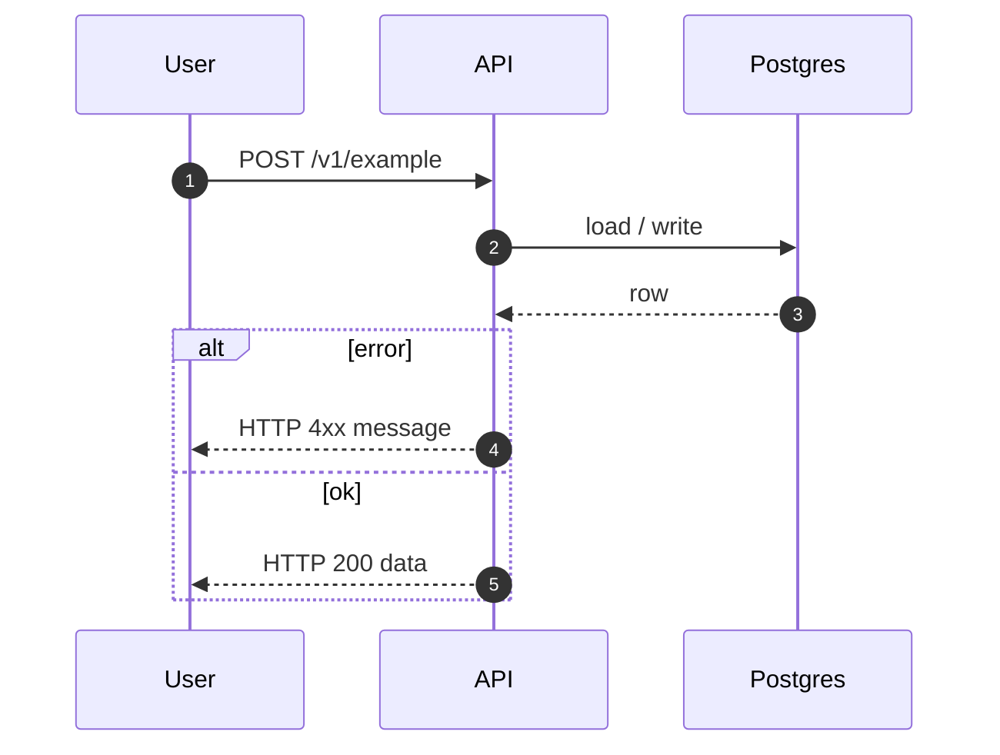

# Swimlane diagrams (Bos Kodingin Stage 2)

Use **Mermaid `sequenceDiagram`** so the diagram **renders in chat** and matches [swimlanes.io](https://swimlanes.io/) style (actors as vertical lanes, messages as arrows).

## Rules

1. Happy path first; add a short `alt` / `else` only when the failure branch changes the design.
2. Label messages with the contract that matters: HTTP method/path, event name, SQL intent, job name.
3. One diagram per feature (or one per major phase if huge).
4. **Required format is `sequenceDiagram`.** Do **not** use Mermaid `flowchart` + `subgraph` “lanes” — those do not read as swimlanes and are hard to scan.
5. Participants = real systems in *this* repo (User, API, Postgres, Redis, Consumer, OpenAI, …). Drop unused ones.
6. Optional: keep a parallel plain [swimlanes.io](https://swimlanes.io/) text block for paste-into-site, but the Mermaid `sequenceDiagram` in the plan is mandatory so it displays.

## Generic template

````markdown

````

## Tips

- Async: include Redis + Consumer participants; show enqueue then consume.
- Prefer `->>` / `-->>` for request/response; use `Note over A,B:` for invariants (e.g. where a gate lives).
- Keep message text short; put signatures and file lists in Tasks / Sketches.
