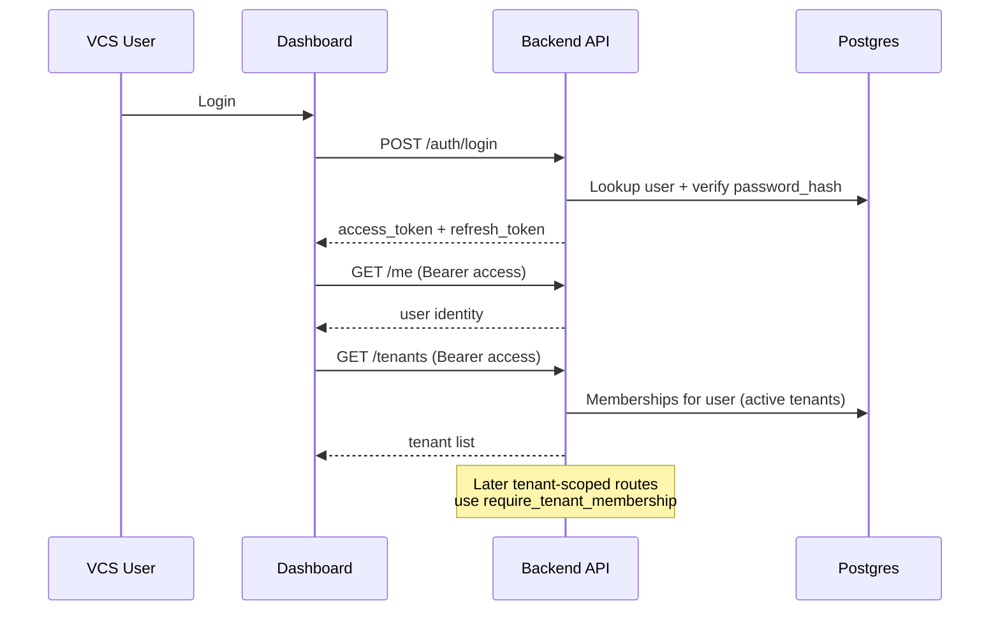
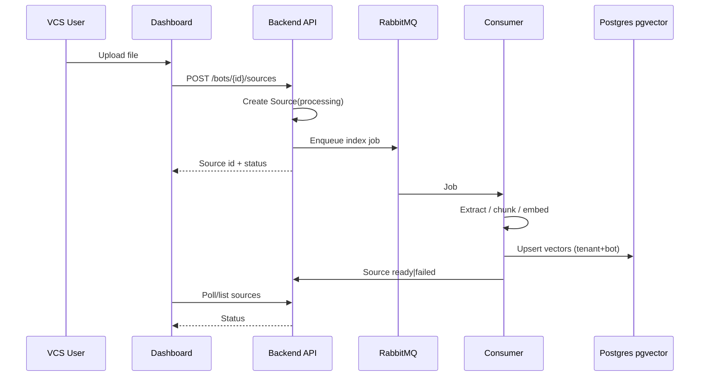
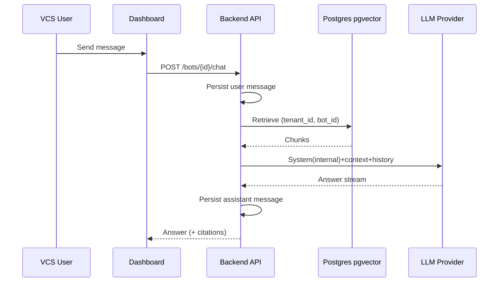

# Data flows

**Last updated:** 2026-10-21

## Auth + tenant context (implemented)

Refresh: `POST /auth/refresh` exchanges a valid refresh JWT for a new access (+ refresh) pair.

## Knowledge upload (P0 — planned)

## Playground chat (P0 — planned)

